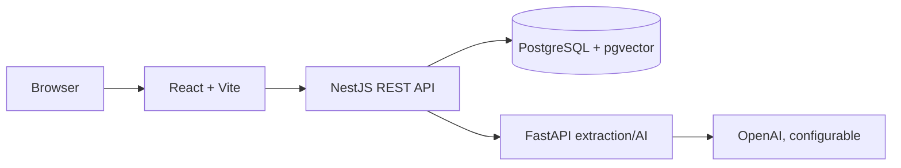

# AI Knowledge & Decision Assistant

A production-minded MVP for organizations that need a public assistant over their private PDF knowledge base. It combines tenant-scoped retrieval, optional OpenAI generation, and deterministic System 1 decision models; it is not a generic PDF chatbot.

## Key capabilities

- Organization registration/login using bcrypt and JWT.
- Isolated organization knowledge bases with private PDF storage and server-side PDF validation (10 files, 10 MB/file, 20 pages/file).
- Assistant tokens stored only as bcrypt hashes, public URL and iframe embed snippet.
- Tenant-filtered retrieval with document/page references and a safe unable-to-answer fallback.
- Parallel Boolean, Choice, and Score decision models followed by a deterministic result combiner.
- Usage analytics, Swagger, Docker Compose, mock AI mode, and automated unit tests.

## Architecture

See [architecture](docs/architecture.md), [AI pipeline](docs/ai-pipeline.md), [decision engine](docs/decision-engine.md), [security](docs/security.md), and [API documentation](docs/api-documentation.md).

## Run locally

1. Copy `.env.example` to `.env` and set a strong `JWT_SECRET`. Keep `MOCK_AI=true` to run without an OpenAI key.
2. Start database and services: `docker compose up --build`.
3. Visit `http://localhost:5173`; Swagger is at `http://localhost:3000/api/docs`.

For iterative local development, run `npm install`, `npm run dev:api`, `npm run dev:web`, and in `ai-service` create a virtual environment then `pip install -r requirements.txt && uvicorn app.main:app --reload`.

## Production configuration

Set `OPENAI_API_KEY`, `OPENAI_CHAT_MODEL`, `OPENAI_EMBEDDING_MODEL`, `DATABASE_URL`, `AI_SERVICE_URL`, and `MOCK_AI=false`. Use managed PostgreSQL with pgvector, encrypted private object storage, HTTPS, secret management, distributed rate limiting, and a durable async job queue before production scale.

## Core endpoint groups

- Auth: `/api/v1/auth/register`, `/login`, `/logout`, `/me`
- Documents: `/api/v1/documents`
- Assistants: `/api/v1/assistants`
- Public: `/api/v1/public/assistants/:token`, `/api/v1/ask`
- Analytics: `/api/v1/analytics/overview`

## Tests

Run `npm test`; Python tests are described in [docs/testing.md](docs/testing.md). Regenerate the six fictional fixture PDFs with `npm run seed:fixtures`. The mock provider ensures automated tests never require paid API calls. The fixture question matrix is in [sample-data/questions.md](sample-data/questions.md).

## Important limitations

This MVP demonstrates the security boundary and orchestration model. Before a production release, replace the in-memory public rate limiter with shared infrastructure, introduce durable job processing, complete pgvector similarity SQL/embedding persistence, and run full integration tests against a clean Postgres database. See the transparent implementation report in [docs/implementation-status.md](docs/implementation-status.md).
