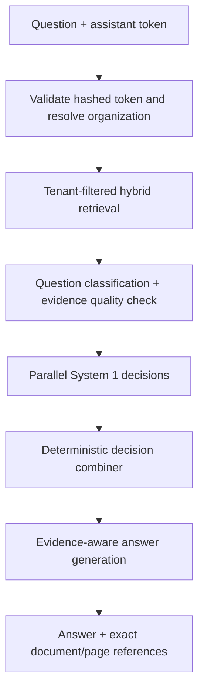

# AI pipeline

PDF processing validates magic bytes, size, organization quota, and page count before extracting page text. The FastAPI endpoint preserves page metadata during chunking. Production embeddings use an environment-selected OpenAI model and pgvector. Mock mode avoids paid requests for tests.

No answer is synthesized if no tenant-scoped chunk matches. An LLM may phrase a final answer but may not invent policy values, citations, or replace the structured decision engine.
