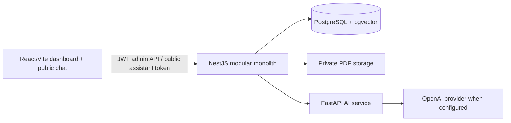

# Architecture

The NestJS boundary resolves an organization from the authenticated JWT for admin operations and from a validated, hashed assistant token for public operations. It never accepts a visitor-provided tenant identifier. Every document, chunk, query log, and lookup is constrained by `organizationId`.

The current MVP uses a modular monolith: auth, documents, assistants, questions, deterministic decision engine, and analytics are independent modules. The FastAPI service owns PDF extraction/chunking and is deliberately independently deployable/testable.
